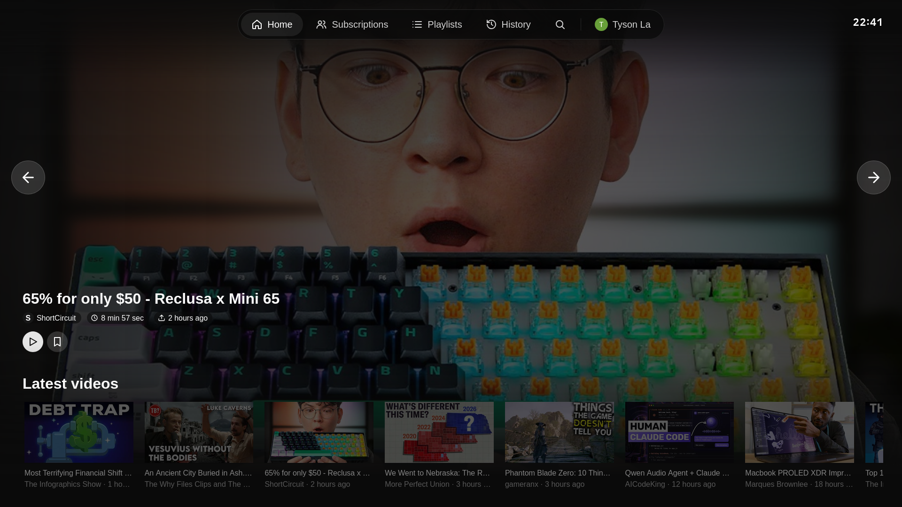
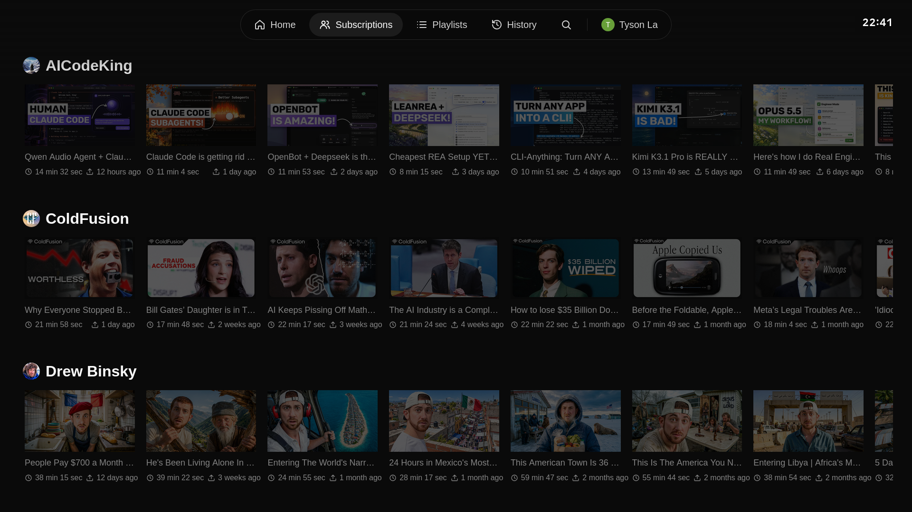
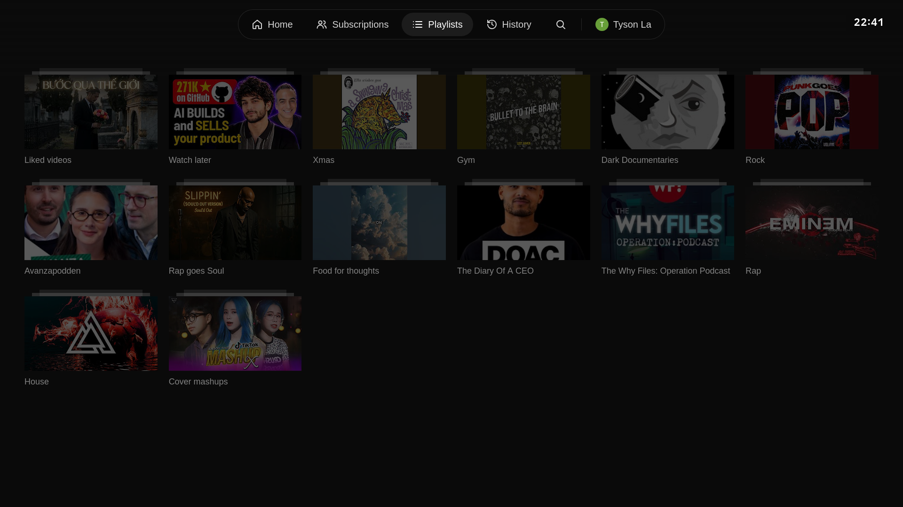
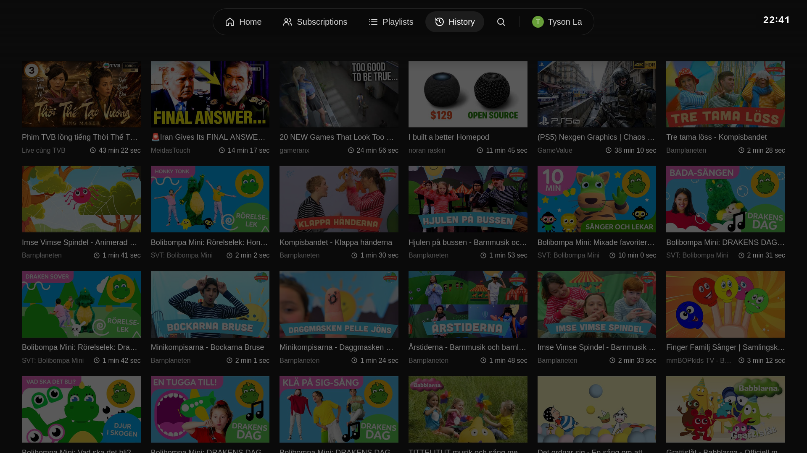
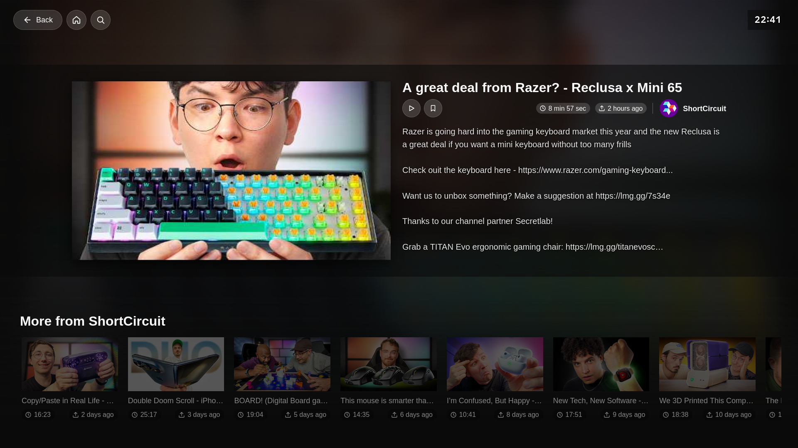

# YouTube Couch

A YouTube client for the TV, built for intentional watching.

Your time is valuable. The stock YouTube app is designed to keep you on it: endless feeds, autoplaying Shorts, ads, and sponsor reads that eat the first minute of every video. You sit down to watch one thing and look up an hour later, not sure what you watched.

YouTube Couch turns that around. Every video you watch is one you chose.

- **Your own YouTube, nothing else.** Sign in with your account and see what matters to you: the latest uploads from channels you subscribe to, your playlists and your history.
- **No endless feed.** Rows stop after a handful of videos instead of scrolling forever, so you can see what is new, decide, and press play.
- **No Shorts.** They are filtered out everywhere.
- **No ads.** Videos start straight away.
- **No sponsor segments.** SponsorBlock skips them for you, so you get to the content.
- **Built for the couch.** The interface is made for a TV and a remote, with D-pad navigation and large, clear thumbnails. There is no phone-sized UI squeezed onto a big screen.

The goal is simple: you open it, find the video you came for, watch it, and get on with your day.

It is built with React, TypeScript and Vite, and runs on Android TV (WebView) and Samsung Tizen (Chrome 76 baseline). You control it with the remote's D-pad.

## Screenshots











## Layout

Bun workspace monorepo.

- `packages/app` — the web app (`@youtube-couch/app`)
  - `src/yt` — YouTube client, TV OAuth, home rows
  - `src/nav` — spatial navigation
  - `src/player` — player and MSE clip handling
  - `src/filters` — ad and Shorts filters
  - `src/sponsorblock` — segment skipping
  - `src/ui` — screens and components
- `packages/tizen` — TizenBrew module: manifest, CORS proxy service, build script

## Requirements

- [Bun](https://bun.sh)

## Develop

```sh
bun install
bun run dev        # Vite dev server, includes CORS proxy at /__proxy
bun run test       # vitest
bun run build:web  # typecheck + production bundle to packages/app/dist
```

Lint from `packages/app`: `bun run lint` (oxlint).

## Install on a Samsung TV with TizenBrew

[TizenBrew](https://github.com/reisxd/TizenBrew) runs web apps on Tizen TVs without Tizen Studio. YouTube Couch is an application module (`packages/tizen`): TizenBrew serves the built app from the TV and runs `service.js`, a small CORS proxy on `127.0.0.1:8082`, in the background.

Publish (needs an npm account; rename the package in `packages/tizen/package.json` if the name is taken):

```sh
bun run build:tizen           # builds the app against the TV proxy and copies it to packages/tizen/dist
cd packages/tizen
npm publish
```

On the TV, open TizenBrew, choose Add Module, enter `npm/youtube-couch-tizen`, then launch YouTube Couch from the module list. TizenBrew loads modules from jsDelivr, so a new version can take a few minutes to appear (or purge the cache at `purge.jsdelivr.net`). Bump `version` for each publish.

## Notes

- Browsers cannot call YouTube directly. The dev and preview servers proxy allowed hosts (`youtube.com`, `googlevideo.com`, `ytimg.com`, `sponsor.ajay.app`) through `/__proxy`. TV wrappers handle this natively (Android WebView request interception, Tizen access rules).
- Build uses a relative base so the bundle loads from `file://` (Tizen `.wgt`, Android assets).

## License

[MIT](LICENSE)
